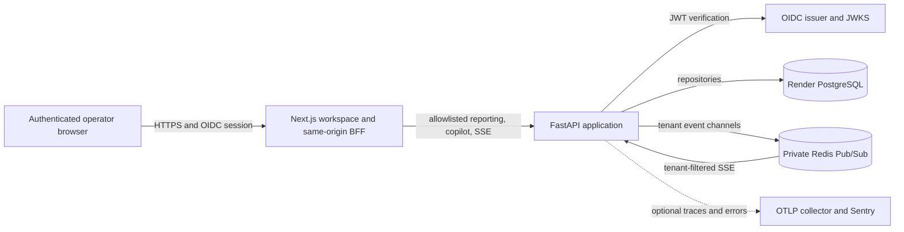

# Launch architecture

## Realtime and notifications

`EventEnvelope` is the versioned transport contract. Publishers submit to a
Redis channel derived from the event's tenant UUID; subscribers derive their
channel from the verified user context, never a request parameter. The API
streams validated events using SSE. The Next.js BFF forwards only the
authenticated `GET /events/stream` request and does not expose Redis or bearer
tokens to browser JavaScript.

Notifications are ephemeral: Redis Pub/Sub does not retain messages, replay
missed events, or provide delivery guarantees. The notification service and UI
are infrastructure only; no commerce, agent, or PayPal workflow publishes
events in this release. Producers must publish safe, tenant-scoped summaries
when separately approved for integration.

## Observability and operations

Every HTTP response receives a generated `X-Request-ID`. Structured request
logs and low-cardinality Prometheus counters/histograms use route templates,
not raw URLs. `/metrics` is disabled unless `METRICS_ENABLED=true` and a
`METRICS_BEARER_TOKEN` are both configured. OTLP traces and Sentry are opt-in
through environment settings; PII capture is disabled.

Readiness checks PostgreSQL. Realtime routes return 503 when Redis is
unavailable; liveness remains independent of infrastructure. Keep the Render
Redis service private because Pub/Sub is an internal transport.

## Render deployment

The root [render.yaml](../render.yaml) declares private Redis, PostgreSQL,
FastAPI, and Next.js services in Singapore. The API runs Alembic as a
pre-deploy command, and only deploys after repository checks pass. The
database URL provided by Render is normalized to the psycopg async SQLAlchemy
driver by backend settings.

1. Connect the repository to Render and create a Blueprint from `render.yaml`.
2. Provide the prompted OIDC, PayPal sandbox, and optional OpenAI/observability
   secrets. Configure matching OIDC issuer/audience/JWKS values on the API and
   issuer/client values on the frontend.
3. Set `NEXTAUTH_URL` to the frontend's HTTPS Render URL and register
   `NEXTAUTH_URL/api/auth/callback/oidc` with the identity provider.
4. Confirm the API `/ready` and frontend `/login` health checks after deploy.
5. Apply the demo dataset only to an explicitly designated non-production
   database; the generator refuses `ENVIRONMENT=production`.

The Render Blueprint uses paid web/database plans; verify current pricing and
region availability before provisioning. Replace the sandbox PayPal setting
only after separate production credential, webhook, and human-approval
readiness reviews.
